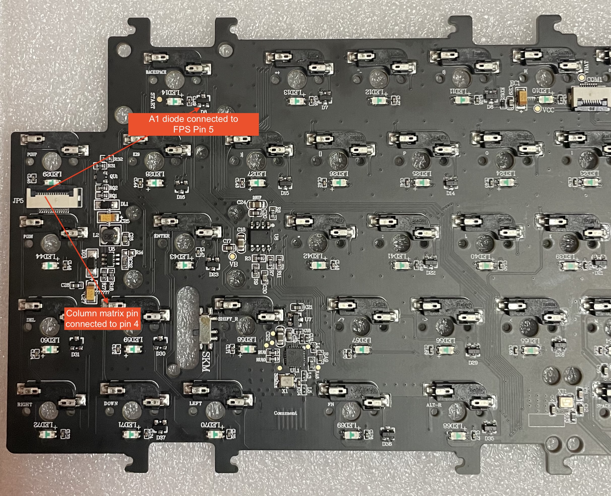
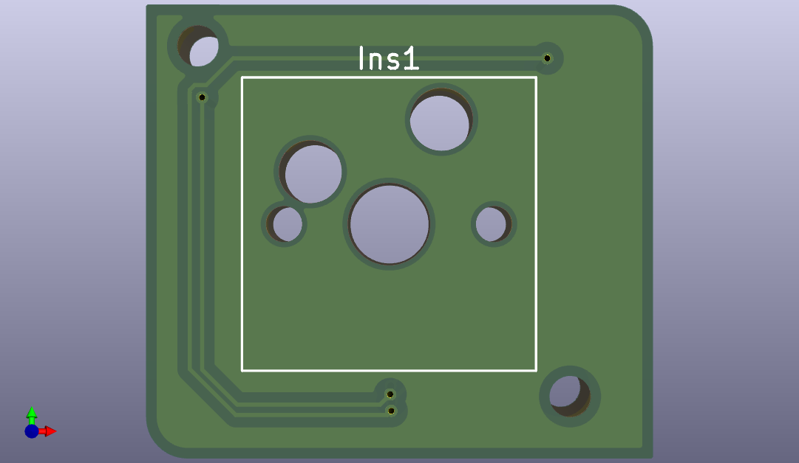
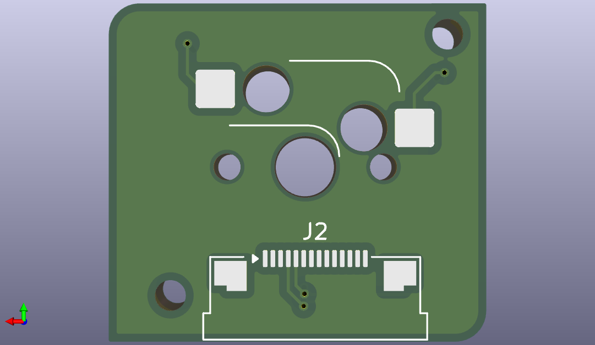

## Single-Key (without LED) v0.1

### Pinouts

#### Switch Matrix

|         | COL       |   0 |    1 |    2 |    3 |    4 |    5 |    6 |    7 |    8 |    9 |   10 |   11 |   12 |   13 |   14 |   15 |
|---------|-----------|----:|-----:|-----:|-----:|-----:|-----:|-----:|-----:|-----:|-----:|-----:|-----:|-----:|-----:|-----:|-----:|
| **ROW** | **_PIN_** | _C1_ | _C2_ | _C3_ | _A0_ | _A1_ | _A2_ | _A3_ | _A4_ | _A5_ | _A6_ | _A7_ | _C4_ | _C5_ | _B0_ | _B1_ | _B2_ |
|   **0** |      _C6_ |     |      |      |      |      |      |      |      |      |      |      |      |      |      |      |      |
|   **1** |      _C7_ |     |      |      |      |      |      |      |      |      |      |      |      |      |      |      |      |
|   **2** |      _C8_ |     |      |      |      |      |      |      |      |      |      |      |      |      |      |      |      |
|   **3** |      _C9_ |     |      |      |      |      |      |      |      |      |      |      |      |      |      |      |      |
|   **4** |      _B14_ |     |      |      |      |      |      |      |      |      |      |      |      |      |      |      |      |

#### Connection layout

#### Ribbon Cable

|         |  1 |   2 |  3 |  4 |      5 |  6 |   7 |   8 |   9 |  10 |     11 |  12 |  13 | 14 |
|---------|---:|----:|---:|---:|-------:|---:|----:|----:|----:|----:|-------:|----:|----:|---:|
| **PIN** | [X] | GND | [X] | C6 | B1 | A8 | B13 | C11 | C10 | VCC | B2 | C14 | C13 | GND |
| **Use** | | | | row 0 | col 14 | | | | | | col 15 | | | |

A meter on one keyboard confirmed pins 2, 4, 5, 6, 7, 8, 9, 10, 12 and 13, with 3.3 V on pin 10. Pin 4 reaches C6 through a diode on the main board, so the module needs no diode. Pin 3 also shows a diode, source not traced. Pin 14 is also ground. Pins 1 and 11 were not measured.

#### Module

