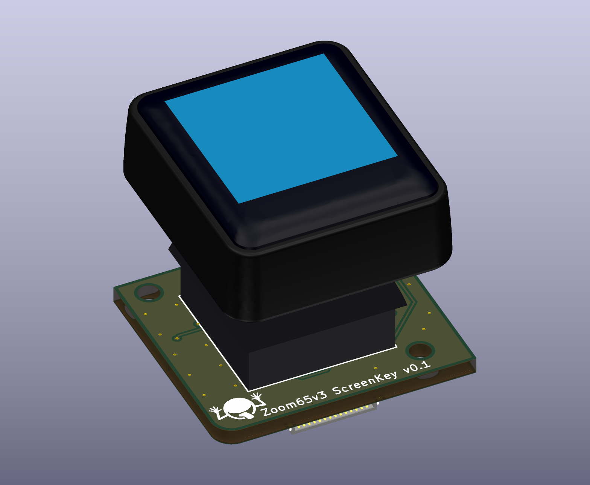
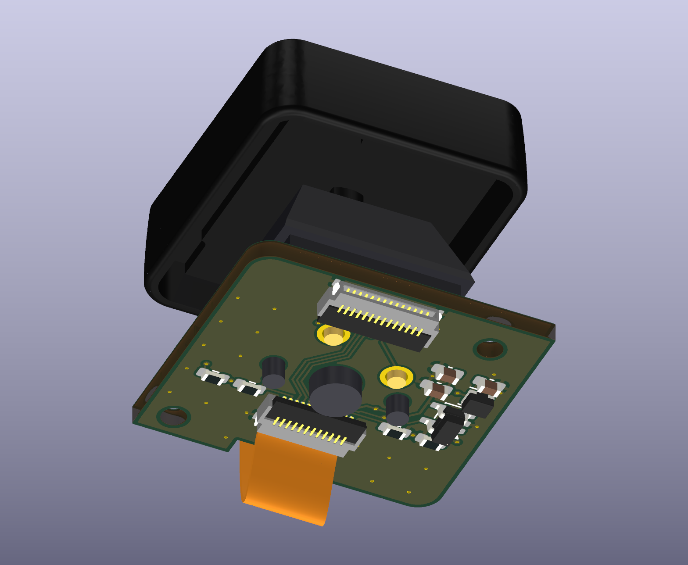
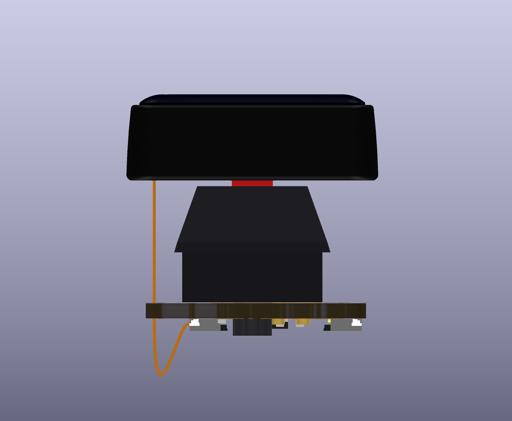
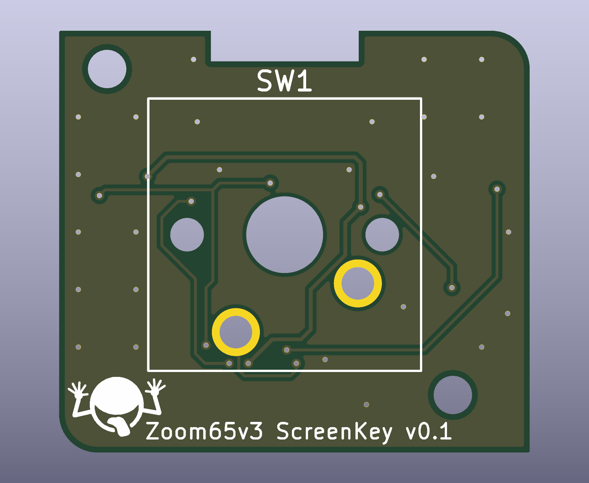
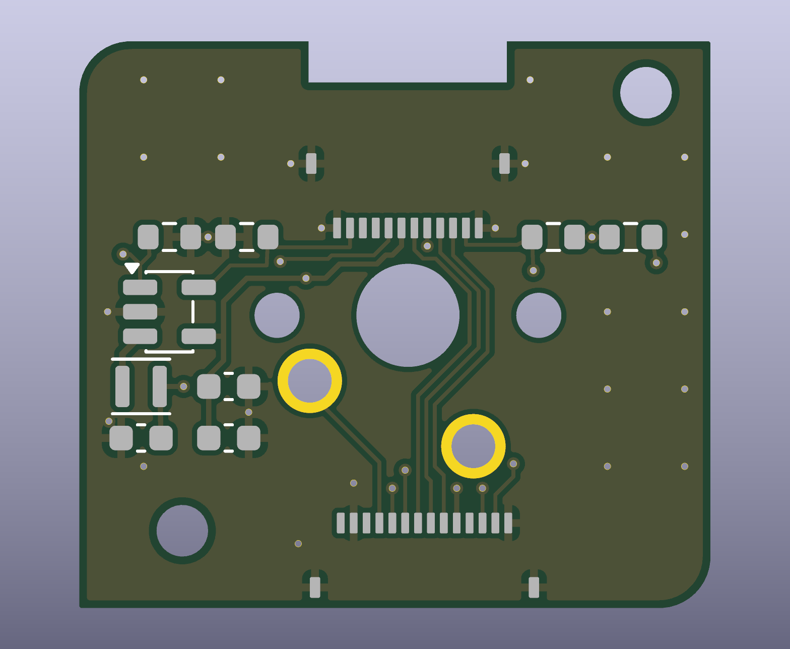

## ScreenKey MX Module v0.1 (untested)

Replacement module for the Zoom65 V3 one-key position. It keeps the `onekey-no-led` outline, holes, switch position and ribbon pin order, and adds a Waveshare 0.85in ScreenKey keycap on a soldered MX switch. The keyboard's MCU drives the display over the 14-pin ribbon.

**v0.1 prototype ordered, not yet built or tested.** The MX fit below has only been checked in CAD.

All images and PDFs are plain KiCad exports. The switch model is simplified, the keycap geometry comes from Waveshare's STEP file, the connector models come from LCSC's EasyEDA library, and the ribbon's bow is an estimate. The blue screen area is a placeholder. The front silkscreen carries a simplified logo about 5 mm wide in the bottom-left corner.

### Parts

| Ref | Part | Purpose |
|---|---|---|
| Keycap | Waveshare 0.85in ScreenKey LCD B, SKU 34087 | Display, plugs into J1, not on the BOM |
| SW1 | MX-style switch | Soldered into plated holes with no plate, rotated 180 degrees so its pins sit south of the center post |
| Optional | Press-in pin sockets for MX switch pins | Not on the BOM, for later hot-swap use |
| J1 | Hirose FH34SRJ-12S-0.5SH(50), LCSC C424659 | 12-pin flex connector, top and bottom contact |
| J2 | Hirose FH34SRJ-14S-0.5SH(50), LCSC C324724 | 14-pin ribbon connector, top and bottom contact |
| U1 | PAM2804AAB010, LCSC C71463 | Backlight driver, in TSOT-25 |
| L1 | Murata DFE201612P-2R2M=P2, LCSC C79317 | 2.2 uH backlight inductor |
| R1 | UNI-ROYAL 0603WAF510KT5E, LCSC C25197 | 5.1R current sense, sets about 20 mA. The panel drawing says 20 mA and its table says 30-60 mA. Waveshare's board uses 5.6R, about 18 mA |
| C2, C3 | 10 uF, LCSC C19702 | Backlight driver output and input |
| R2 | 100k | Holds the backlight off until firmware drives it |
| R3, R4 | 10k | Hold RST and CS inactive |
| C1 | 100 nF | Panel supply decoupling |

The backlight is dimmed with PWM on the driver's EN pin. Its datasheet recommends 500 Hz.

### Ribbon Cable (J2)

| Pin | MCU | Net | Meter check at the MCU |
|---:|---:|---|---|
| 2 | - | `GND` | Continuity to ground |
| 4 | C6 | `KEY_ROW` (row 0) | Through a main board diode, 0.564 V from C6 to pin 4 |
| 5 | B1 | `KEY_COL` (column 14) | Continuity |
| 6 | A8 | `LCD_BL_PWM` | Continuity |
| 7 | B13 | `LCD_DC` | Continuity |
| 8 | C11 | `LCD_SCK` | Continuity |
| 9 | C10 | `LCD_MOSI` | Continuity |
| 10 | - | `+3V3` | 3.3 V with the keyboard powered |
| 12 | C14 | `LCD_RST` | Continuity |
| 13 | C13 | `LCD_CS` | Continuity |
| 14 | - | `GND` | Continuity to ground |

These checks were made on one keyboard and prove connections only. No key press or display signal has been tested through the ribbon. To find pin 1, look for ground on the 2nd contact in from one end: that end holds pin 1, and C13 is 2nd in from the other end.

The keyboard's main board already has the key's diode, so the module needs none. The main board schematic disagrees with these measurements at pin 2, which it leaves blank, and pin 4.

Pins 1, 3 and 11 are not connected. Pin 3 reads like pin 4 from ground, about 1.09 V in diode mode, but its source was not traced. Pins 1 and 11 were not measured. Switch pin 1 carries `KEY_ROW` and pin 2 carries `KEY_COL`. Firmware must disable the encoder and UART3, and use an ST7735 driver. The switch is rotated 180 degrees, but the keycap stays right side up: the ribbon and thin bezel are at the top, and the wide bezel is at the bottom. The key stays in the normal matrix.

### Keycap Connector (J1)

| Pin | Panel | Net |
|---:|---|---|
| 1, 12 | GND | `GND` |
| 2 | LEDK | `LED_K` |
| 3, 4 | NC | Not connected |
| 5 | LEDA | `LED_A` |
| 6 | VDD | `+3V3` |
| 7 | DC | `LCD_DC` |
| 8 | CS | `LCD_CS` |
| 9 | SCLK | `LCD_SCK` |
| 10 | MOSI | `LCD_MOSI` |
| 11 | RST | `LCD_RST` |

### Assembly

1. Solder the switch to the board and trim its side pins and contact pins close to the back. The center post stays intact. The keyboard plate is cut out here, so only the board holds the switch.
2. Pass the flex through the board's top-edge notch.
3. Plug the flex into J1, then press the keycap onto the stem.
4. Plug the ribbon into J2.

### Risks to check before ordering

- **Keycap tail fit:** the panel drawing shows a 0.30 +/-0.05 mm tail with 0.35 +/-0.04 mm fingers. J1 recommends 0.30 +/-0.03 mm and 0.30 +/-0.03 mm, so a tail at the tolerance limit could be loose or tight. Test J1 with a real keycap.

- **Stem fit:** the keycap's socket is 2.9 mm deep with 1.16 mm arms in Waveshare's CAD. A typical MX stem is about 3.6 mm tall with arms of about 1.17 and 1.31 mm, from memory rather than a drawing, so the wider arm may be tight.
- **Flex slack:** J1 is now about 6 mm closer to the notch, leaving about 7 mm of extra flex. This depends on the MX height, which is from memory.
- **Center post:** it stays intact and sticks out about 1.7 mm behind the board, a figure from memory. J1's rear edge clears the post hole by about 0.3-1.2 mm, depending on which way the connector's full 3.8 mm depth extends. Check this against a real connector. Removing a soldered switch means desoldering it, and the keycap must come off first.
- **Rear clearance:** the extra flex forms a bow about 5.6 mm behind the board in the model and grows on each press. J1 and J2 stand 1 mm. The clearance in the case has not been measured, and this is now the main fit risk.
- **Keycap clearance:** the keycap is 21.89 x 25.13 mm and its top is about 20.8 mm above the board's front face. The case opening has not been checked.
- **Mounting:** the board keeps the 2.0 mm `onekey-no-led` holes, but what they fasten to has not been confirmed, so the renders show no posts or screws.
- **Ribbon fit:** the FH34 needs a 0.3 +/-0.03 mm ribbon end with about 1.5 mm of exposed contacts, and the ribbon has not been measured. Its dual contacts accept the ribbon either way up, so keep the pin order matched to the footprint. The pin map above was checked with a meter on the keyboard.

### Hot-swap Option

The 3.05 mm holes for a Kailh socket cannot also hold a soldered switch, so this board uses 1.7 mm plated holes. Hot-swap would need press-in pin sockets that fit those holes, or a board revision with the `onekey-no-led` socket footprint. The pin socket fit has not been checked.

### Files

- `Kicad/`: KiCad project. The schematic is in KiCad 9 format and the board was saved by KiCad 10, so open it in KiCad 10. The J1 footprint and U1 symbol are stored in the design, not in a library.
- `Kicad/production/`: Gerbers and drills, BOM and placement files for the back-side parts. SW1 is left out because it is hand-soldered. J1 and J2 placement uses the center of their pads, so check their position and rotation in the fab's preview, along with every other back-side part.
- `docs/schematic.pdf`, `docs/pcb-layout.pdf`: KiCad exports of the schematic and of each board side, with copper, silkscreen, pads and part labels.
- `Kicad/3d/`: 3D models used by the board. The small parts are from KiCad's library, and the connectors are from LCSC's EasyEDA library, so check their terms before redistributing them.
- `docs/module-assembly.step`: assembly model, including geometry from Waveshare's STEP file.
- `docs/ScreenKey-Module-drawing.pdf`: Waveshare's module drawing.

DRC reports no violations and no unconnected items. The one parity warning is a `Datasheet` field difference on SW1. The routes were planned by hand and written by a script, and the board has not been opened in the KiCad GUI.
